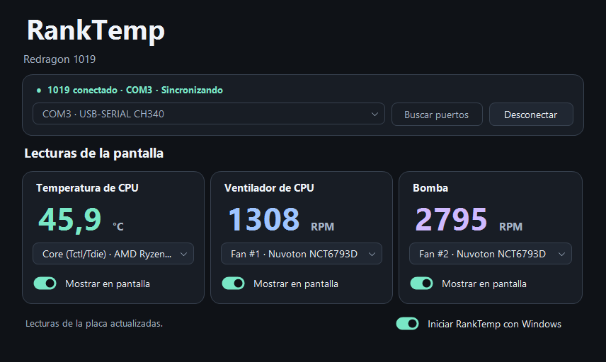

# RankTemp

RankTemp es una aplicación para Windows que envía la **temperatura de la CPU** y las **RPM del ventilador y de la bomba** a la pantalla de la refrigeración **Redragon 1019**. Puedes usarla con CpuTemp cerrado.

**[Descargar RankTemp para Windows x64](https://github.com/rekznoz/RedDragon-1019/releases/latest/download/RankTemp-Windows-x64.zip)** · [Versiones y notas de publicación](https://github.com/rekznoz/RedDragon-1019/releases)



## Características

- Tres tarjetas de lectura con selección de sensores e interruptores para mostrar u ocultar cada valor en el 1019.
- Conexión al puerto guardado y reintento automático si Windows interrumpe la comunicación, incluso tras salir de suspensión.
- Sincronización desde la bandeja de Windows e inicio automático opcional al iniciar sesión.
- Actualización de la copia de inicio con el puerto y los sensores guardados.
- Si un sensor deja de responder, RankTemp oculta su lectura y mantiene la conexión con la pantalla.

## Requisitos y compatibilidad

- Windows de 64 bits con .NET Framework 4.7.2 o posterior.
- Redragon 1019 conectado por USB y reconocido por Windows como puerto COM. La unidad probada usa el adaptador CH340 con identificador USB `1A86:7523`.
- Permisos de administrador para activar PawnIO, acceder a los sensores que lo requieran y configurar el inicio con Windows.

Las tres lecturas se han probado en un **Ryzen 7 5700X** con una **ASRock B450M-HDV R4.0**. En ese equipo se usaron `Core (Tctl/Tdie)` para la CPU, `Fan #1` para el ventilador y `Fan #2` para la bomba. Los nombres de los sensores y las RPM disponibles dependen de la placa y del cableado. La compatibilidad con otros modelos de refrigeración queda por verificar.

## Instalación

1. Descarga el ZIP y extrae la carpeta completa.
2. Cierra CpuTemp, incluido su icono en la bandeja, para liberar el puerto COM.
3. Abre `RankTemp.exe`. Si aparece **Activar sensores**, acepta la instalación de PawnIO y el aviso de Windows. RankTemp volverá a abrirse cuando termine. Si PawnIO ya está instalado, RankTemp lo reutiliza.
4. Selecciona el puerto del 1019 y pulsa **Conectar**. RankTemp preselecciona el puerto cuando detecta un único CH340 compatible.
5. Elige los sensores de temperatura, ventilador y bomba. Activa **Mostrar en pantalla** para cada lectura que quieras enviar al 1019.

## Uso diario

- **Minimizar** envía RankTemp a la bandeja. Haz doble clic en su icono junto al reloj para restaurar la ventana o usa **Salir** para cerrar la aplicación.
- Si cierras RankTemp con el 1019 conectado, volverá a buscarlo en el mismo puerto al abrirlo. **Desconectar** borra el puerto recordado y **Cancelar** detiene los reintentos.
- **Iniciar RankTemp con Windows** crea una tarea para tu cuenta y guarda una copia de la aplicación en Archivos de programa. Al iniciar sesión, RankTemp abre en la bandeja y usa la configuración guardada. Desmarca la casilla para eliminar la tarea.

## Actualización

1. Sal de la versión anterior desde la bandeja.
2. Extrae el ZIP nuevo y abre su `RankTemp.exe`.
3. Si ya usabas el inicio con Windows, pulsa **Actualizar copia de inicio**. La tarea pasará a usar la nueva versión al iniciar sesión.

RankTemp guarda el puerto, los sensores y las opciones de pantalla por cuenta de Windows. Puedes extraer la nueva versión en otra carpeta y recuperar esos ajustes.

## Solución de problemas

| Síntoma | Qué comprobar |
| --- | --- |
| RankTemp no encuentra el 1019 | Confirma que Windows muestra un puerto CH340 en el Administrador de dispositivos. Pulsa **Buscar puertos** y selecciona el COM correspondiente. |
| No se puede abrir el puerto | Cierra CpuTemp por completo y comprueba que solo hay una instancia de RankTemp abierta. |
| La temperatura o las RPM aparecen como un guion | Comprueba que PawnIO esté activo, acepta el aviso de administrador y elige el sensor correspondiente. Si la placa no expone las RPM de una conexión, deja ese campo en **Sin asignar**. |
| El valor aparece en RankTemp pero no en el 1019 | Comprueba que RankTemp está sincronizando y que **Mostrar en pantalla** está activado para esa lectura. |
| Tras actualizar, Windows sigue abriendo la versión anterior | Sal de la copia anterior, abre el ejecutable del ZIP nuevo y pulsa **Actualizar copia de inicio**. |

Si necesitas ayuda, indica el modelo de refrigeración, la placa base, la versión de RankTemp y el mensaje que aparece. [Abrir un issue en GitHub](https://github.com/rekznoz/RedDragon-1019/issues)

## Compilar desde el código fuente

Ejecuta este comando en PowerShell desde la raíz del repositorio.

```powershell
.\RankTemp\Build-RankTemp.ps1 -IncludeSensorDriver
```

El script usa el compilador de .NET Framework, descarga las versiones fijadas de las dependencias y comprueba sus hashes SHA-256. El resultado se guarda en `RankTemp/dist/RankTemp-Windows-x64.zip`. El parámetro `-IncludeSensorDriver` añade el instalador de PawnIO al paquete.

- [Código de la aplicación](RankTemp/src)
- [Documentación del protocolo y pruebas de conexión](RankTemp/README.md)
- [Captura USB del arranque](RankTemp-1019-arranque.pcapng) y [captura de la telemetría](RankTemp-1019-temperatura.pcapng)

## Dependencias

RankTemp es un proyecto independiente basado en el análisis del protocolo del 1019. Usa LibreHardwareMonitor para leer los sensores y PawnIO para acceder a los sensores que requieren un controlador de Windows. El ZIP incluye los avisos de licencia correspondientes. [LibreHardwareMonitor 0.9.6](https://github.com/LibreHardwareMonitor/LibreHardwareMonitor/tree/v0.9.6) · [PawnIO 2.2.0](https://github.com/namazso/PawnIO.Setup/releases/tag/2.2.0)
